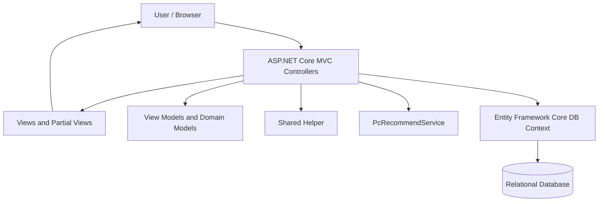

[PCBuildLab_README.md](https://github.com/user-attachments/files/34239338/PCBuildLab_README.md)
# PC Build Lab

**Build smarter. Compare components. Learn how your PC fits together.**

PC Build Lab is a web-based PC configuration and hardware discovery application developed with **C#** and **ASP.NET Core MVC**. It brings together a hardware catalogue, a custom PC builder, budget-based recommendations, beginner-friendly learning guides, and a community for sharing builds.

The project is designed to help users make informed choices when planning a PC, while providing administrative tools for maintaining hardware records and educational content.

## Contents

- [Project Goals](#project-goals)
- [Core Features](#core-features)
- [Languages and Technologies](#languages-and-technologies)
- [System Architecture](#system-architecture)
- [Programming Techniques Used](#programming-techniques-used)
- [How the Main Workflows Operate](#how-the-main-workflows-operate)
- [Controller Reference](#controller-reference)
- [Domain Model Overview](#domain-model-overview)
- [Getting Started](#getting-started)
- [Security and Implementation Notes](#security-and-implementation-notes)
- [Potential Enhancements](#potential-enhancements)

## Project Goals

- **Simplify PC building:** Let users assemble a configuration from categorized hardware options.
- **Support better decisions:** Provide hardware details, filtering, sorting, and same-category comparison.
- **Respect a budget:** Offer suggested component combinations based on a user-supplied budget and optimization preference.
- **Promote hardware literacy:** Organize educational guides and track which guides signed-in users have opened.
- **Encourage collaboration:** Let users publish builds and discuss them through comments and ratings.
- **Enable maintenance:** Give authorized users tools to manage the hardware catalogue and guide content.

## Core Features

### 1. Account and Profile Management

The account module supports registration, login, logout, profile editing, avatar uploads, password changes, and password-reset emails.

- Checks for duplicate emails and usernames during registration.
- Uses a shared `Helper` service for password hashing, password verification, and sign-in/sign-out operations.
- Supports a **Remember Me** option during login.
- Restricts profile and password changes to authenticated users via `[Authorize]`.
- Validates uploaded avatar files through the helper before saving them.

**Implemented in:** `AccountController.cs`

### 2. Custom PC Builder

Users can construct and manage their own component lists using the following categories:

| Category | Purpose |
| --- | --- |
| Motherboard | Main board for connecting components |
| CPU | Processor |
| RAM | System memory, with support for multiple RAM selections |
| GPU | Graphics card |
| Storage | Storage device |
| Power supply unit | Power delivery |
| CPU cooler | Processor cooling |
| PC case | Computer enclosure |

The builder can create, display, edit, and delete saved builds. It calculates a build price from selected hardware records and stores the selected parts as build details. A recommended configuration can also be opened as a **draft** for manual changes before saving.

**Current compatibility checks:** The saved-build listing checks CPU-versus-motherboard sockets, RAM-versus-motherboard DDR types, and a limited motherboard/case form-factor condition. These checks are not a complete compatibility engine; for example, the supplied controller does not demonstrate full PSU wattage, GPU clearance, or cooler clearance validation.

**Implemented in:** `BuildController.cs`

### 3. Budget-Based PC Recommendations

Users enter a budget and choose an optimization preference. The controller delegates the recommendation process to `PcRecommendService` and shows its result.

- Minimum accepted budget: **RM 1,000**.
- Default budget shown by the controller: **RM 5,000**.
- Recommended components can be **saved directly** to the user's builds.
- Alternatively, a recommended combination can be saved as a **draft** and opened in the configurator for customization.

The specific ranking/optimization algorithm is defined in `PcRecommendService`, which was **not included** in the reviewed files. This README therefore does not label the recommendation process as AI, machine learning, genetic algorithms, or any other unverified technique.

**Implemented in:** `RecommendController.cs` (delegates to `PcRecommendService`)

### 4. Hardware Catalogue and Comparison

The catalogue provides a searchable view of computer parts, with features to:

- Filter components by category and brand.
- Search names, categories, and brands through a partial-view endpoint.
- Sort by price or rating, ascending or descending.
- Display individual hardware specifications.
- Compare **two distinct products from the same hardware category**.
- Feature top-rated components on the home page (up to ten items).

The catalogue includes an endpoint that returns an HTML partial view, which supports refreshing a hardware grid without rendering the entire page again.

**Implemented in:** `HardwareController.cs`, `HomeController.cs`

### 5. Community Builds

Signed-in users can publish an existing saved build to the community, optionally providing an image and an author's note.

- Search shared builds by build name or author username.
- Sort posts by recency or average rating.
- Leave comments (up to **1,000 characters** as validated by the controller).
- Rate builds from **1 to 5**, with the option to update a previous rating.
- Recalculate each community build's average rating and rating count when a rating is submitted.
- Remove a related community entry, comments, and ratings when its underlying saved build is deleted.

**Implemented in:** `CommunityController.cs`, `BuildController.cs`

### 6. Learning Centre

The learning module displays guides in a configurable order and supports navigation to the previous or next guide. Opening a guide while signed in records that the user has viewed it, enabling reading-progress indicators.

Guide management supports a structured set of modules:

- **Title** modules for section headings.
- **Content** modules for paragraphs.
- **Image** modules with optional captions.

These modules are stored as JSON and transformed into HTML for display.

**Implemented in:** `LearningController.cs`, `LearningAdminController.cs`

### 7. Hardware Administration

Hardware administrators can add, modify, and delete catalogue records, including:

- Names, brands, prices, descriptions, and categories.
- Display images and additional component images.
- Technical attributes such as socket, DDR type, form factor, and available RAM slots.
- Release year, ratings, power consumption, and performance-related scores.

Hardware management is explicitly restricted with `[Authorize(Roles = Roles.Admin)]` in the reviewed code.

**Implemented in:** `HardwareAdminController.cs`

## Languages and Technologies

This project uses several technologies for different layers of a traditional MVC web application.

| Language / Technology | Role in the project | Where it appears in the reviewed code |
| --- | --- | --- |
| **C#** | Core programming language for application logic, validation, data operations, and controllers | All nine controllers |
| **ASP.NET Core MVC** | Organizes requests into controller actions and responses into views, redirects, or partial views | `Controller`, `IActionResult`, `View()`, `RedirectToAction()` |
| **Entity Framework Core** | Object-relational mapping (ORM) and database access | `db.Users`, `db.Builds`, `SaveChanges()`, `Include()` |
| **LINQ** | Filtering, searching, sorting, projection, aggregation, and relationships in C# | `Where()`, `OrderBy()`, `Any()`, `Sum()`, `Average()` |
| **ASP.NET Core Authorization** | Restricts actions according to authentication status or role | `[Authorize]`, `[Authorize(Roles = Roles.Admin)]` |
| **HTML / MVC Views** | Presents results generated by controllers; a reusable HTML hardware grid is returned through a partial view | `View()`, `PartialView("_HardwareCardGrid", hardware)` |
| **JSON (`System.Text.Json`)** | Serializes and deserializes structured learning-guide modules | `JsonSerializer.Serialize()` and `Deserialize()` |
| **Email (`System.Net.Mail`)** | Builds password-reset email messages for a helper to send | `MailMessage`, `hp.SendEmail()` |
| **SQL / relational database** | Stores users, hardware, builds, guides, and community records | EF Core's `DB` context and a database-diagnostics SQL query |

**Database clarification:** The learning diagnostic method uses SQL Server-style string concatenation (`TABLE_SCHEMA + '.' + TABLE_NAME`), suggesting a SQL Server-oriented setup. The actual database provider, connection-string name, migrations, and schema initialization need verification from the `DB` context and application configuration files.

**Frontend clarification:** MVC views and an AJAX-oriented partial-view endpoint are evident, but the actual `.cshtml`, JavaScript, CSS, and frontend framework files were not provided. No specific frontend libraries are claimed here.

## System Architecture

The controllers follow the **Model–View–Controller (MVC)** pattern. Controllers accept web requests, validate input, coordinate domain operations, query or update data, then return a view or redirect.



**Main architectural responsibilities**

- **Controllers:** HTTP request handling and coordination (`AccountController`, `BuildController`, etc.).
- **View models:** Carry form fields and page-specific data, such as `ConfigureBuildVM`, `RegisterVM`, and `RecommendBuildVM`.
- **Domain models:** Represent stored entities such as `User`, `Hardware`, `Build`, `Community`, and `Guide`.
- **`DB` context:** Provides the EF Core collections and persistence operations consumed by controllers.
- **`Helper`:** Exposes reusable operations for authentication, password handling, email, and image validation/storage.
- **`PcRecommendService`:** Provides recommendation results to the recommendation controller; its internal algorithm was not included in the review.

> This diagram is a **controller-level architecture overview**, not a verified directory tree or a complete depiction of service internals.

## Programming Techniques Used

The following sections highlight concrete techniques visible in the uploaded code—not just framework names.

### 1. MVC Separation of Concerns

The project separates request logic into focused controllers. For example, `HardwareController` handles browsing and comparing parts, whereas `HardwareAdminController` handles changes to hardware records.

This helps keep different use cases easier to navigate, debug, and maintain. View models also avoid passing raw form input directly into every database operation.

### 2. Dependency Injection (DI)

Required services are supplied through controller constructors instead of being instantiated directly inside each action.

```csharp
public RecommendController(PcRecommendService recommend, DB db)
{
    _recommend = recommend;
    _db = db;
}
```

**Why it matters:** Dependency injection reduces direct coupling and makes controller dependencies visible, supporting easier testing and maintenance. Similar constructor injection is used for the `DB` context, `Helper`, and hosting environment in other controllers.

### 3. LINQ and Entity Framework Core Queries

The hardware catalogue builds database queries from the user's selected filters and sorting options.

```csharp
var query = db.Hardware.Include(h => h.Category).AsQueryable();

if (categoryId.HasValue)
    query = query.Where(h => h.CategoryId == categoryId.Value);

if (!string.IsNullOrWhiteSpace(brand))
    query = query.Where(h => h.Brand != null &&
        h.Brand.Trim().ToLower() == brand.Trim().ToLower());
```

**Why it matters:** LINQ provides readable, composable data queries. `AsQueryable()` lets the code add conditions before retrieving results, while `Include()` loads related category data through EF Core.

Other examples in the code include `Sum()` for calculating total component prices and `Average()` for calculating community ratings.

### 4. Model Binding and Server-Side Validation

Form data is received through view models, and controller actions check business rules before saving changes.

```csharp
[HttpPost]
public async Task<IActionResult> Index(RecommendBuildVM vm)
{
    if (vm.Budget < 1000)
    {
        ModelState.AddModelError("Budget", "Minimum budget is RM 1,000.");
        return View(vm);
    }

    var result = await _recommend.RecommendAsync(
        vm.Budget, vm.OptimizationType);

    ViewBag.Result = result;
    ViewBag.Budget = vm.Budget;
    return View(vm);
}
```

**Why it matters:** Server-side checks help stop invalid inputs from reaching later processing. Other actions validate duplicated accounts, missing build names, required images, invalid rating values, and category mismatch during comparison.

### 5. Authentication, Authorization, and Ownership Checks

The application uses authorization attributes for protected actions:

```csharp
[Authorize(Roles = Roles.Admin)]
public class HardwareAdminController : Controller
```

The build actions also verify that a requested build belongs to the signed-in user:

```csharp
var build = db.Builds
    .FirstOrDefault(b => b.BuildId == id && b.UserId == userId);
```

**Why it matters:** Authentication identifies the user, role-based authorization restricts specific administrative actions, and ownership filters prevent users from operating on other users' builds through these endpoints.

### 6. Relational Data Modeling

The code represents each saved PC configuration with a `Build` record and one or more `BuildDetail` records linking it to selected hardware IDs.

```csharp
foreach (var hid in selectedIds)
    db.BuildDetails.Add(new BuildDetail
    {
        BuildId = build.BuildId,
        HardwareId = hid,
        Quantity = 1
    });

db.SaveChanges();
```

**Why it matters:** Keeping build metadata separate from component selections avoids storing an entire configuration in a single text field. It also allows EF Core navigation properties to load associated hardware information.

### 7. Conditional Compatibility Checking

The saved-build listing applies specific rules based on hardware characteristics, such as comparing CPU and motherboard sockets.

```csharp
if (mb != null && cpu != null &&
    !string.IsNullOrEmpty(mb.Socket) &&
    !string.IsNullOrEmpty(cpu.Socket) &&
    mb.Socket != cpu.Socket)
    return true;
```

**Why it matters:** This demonstrates rule-based validation using component attributes. In the provided code, compatibility reporting is limited to a few supported rules and does not validate every possible PC hardware constraint.

### 8. Asynchronous Programming (`async` / `await`)

The recommendation action invokes its service asynchronously:

```csharp
var result = await _recommend.RecommendAsync(
    vm.Budget, vm.OptimizationType);
```

The learning diagnostic endpoint also uses `ToListAsync(ct)` with a cancellation token.

**Why it matters:** Asynchronous controller actions can avoid blocking a request thread while awaiting supported operations. The service implementation would need to be reviewed to determine which of its internal operations are truly asynchronous.

### 9. Partial Views for Dynamic Page Updates

The hardware catalogue includes a dedicated action returning only the hardware grid:

```csharp
return PartialView("_HardwareCardGrid", hardware);
```

**Why it matters:** Partial views allow a client-side request to update a portion of a page, such as filtered search results, without returning the entire page layout. The controller supplies an endpoint intended for this type of interaction; the browser-side JavaScript was not part of the supplied files.

### 10. JSON-Based Content Modules and HTML Encoding

Learning guides use `System.Text.Json` for storing a list of content modules and transform those modules into HTML. Text content and captions are passed through `System.Net.WebUtility.HtmlEncode()`.

**Why it matters:** JSON provides a structured representation of guide content, and HTML encoding helps prevent text values from being interpreted as arbitrary HTML. The full safety of rendered image URLs and stored content depends on the surrounding views and validation, which were not reviewed.

### 11. File Management and Email Integration

Shared helper methods support image validation, file storage, file deletion, and email delivery. They are used for profile avatars, hardware images, and community build images. The account module also constructs password-reset emails.

**Why it matters:** Reusing helper methods avoids repeating file and email handling code in every controller. The exact file restrictions, hashing algorithm, and email transport configuration depend on `Helper`, which was not included.

## How the Main Workflows Operate

### Build a PC manually

1. Sign in and open the PC configurator.
2. Select components from the supported hardware categories, including multiple RAM entries where appropriate.
3. Submit a build name and component selections.
4. The controller validates the submitted model, obtains the selected IDs, and calculates a total from hardware prices.
5. EF Core saves the `Build` and related `BuildDetail` records.
6. The user is redirected to the build details page.

### Generate and customize a recommended PC

1. Enter a budget (at least RM 1,000) and choose an optimization preference.
2. The controller calls `PcRecommendService.RecommendAsync(...)`.
3. Review the recommendation presented in the view.
4. Choose **Save Build** to create a saved build, or **Configure Build** to create a draft.
5. A draft can be opened in the manual configurator and adjusted before saving.

### Share a build with the community

1. Sign in and open one of your saved builds.
2. Use the share action and optionally submit a build image and note.
3. The application creates a `Community` record linked to that build.
4. Other signed-in users can comment and give ratings from 1 to 5.
5. The application updates the stored average rating and rating count.

## Controller Reference

| Controller | Main responsibilities | Representative actions |
| --- | --- | --- |
| `HomeController` | Homepage and top-rated hardware | `Index` |
| `AccountController` | Accounts, profiles, passwords, login/logout | `Register`, `Login`, `UpdateProfile`, `ResetPassword` |
| `HardwareController` | Catalogue, filters, details, comparison | `List`, `ListPartial`, `Detail`, `Compare` |
| `HardwareAdminController` | Admin-only hardware CRUD | `Index`, `Create`, `Edit`, `Delete` |
| `BuildController` | Build configuration, drafts, saved builds | `Configure`, `Index`, `Detail`, `Edit`, `Delete` |
| `RecommendController` | Recommendations and build handoff | `Index`, `SaveBuild`, `ConfigureBuild` |
| `CommunityController` | Sharing, comments, ratings | `Index`, `Detail`, `Share`, `Comment`, `Rate` |
| `LearningController` | Reading and tracking guides | `Index`, `Detail` |
| `LearningAdminController` | Guide content management | `Index`, `Create`, `Edit`, `Save`, `Delete` |

**Important access distinction:** `HardwareAdminController` requires the `Admin` role, while `LearningAdminController` currently has `[Authorize]` without an admin-role restriction in the reviewed source. Do not assume both controllers have identical permissions.

## Domain Model Overview

The controllers refer to these application entities and relationships:

| Entity | What it represents |
| --- | --- |
| `User` | Registered account and profile |
| `Category` | Hardware category, such as CPU or GPU |
| `Hardware` | Component details, pricing, images, and specifications |
| `Build` | A saved, user-owned PC configuration |
| `BuildDetail` | A component selected in a saved build |
| `DraftBuild` / `DraftBuildDetail` | Temporary recommended configuration before final save |
| `Community` | Published version of a saved build |
| `CommunityComment` | Comment from a user on a community build |
| `CommunityRating` | User rating on a community build |
| `Guide` | Educational content and its display order |
| `UserGuideProgress` | Record of a guide viewed by a signed-in user |

These relationships are inferred from entity usage, foreign-key fields, and EF Core navigation properties in the supplied controllers. They are **not** a verified full database schema or ER diagram.

## Getting Started

### Prerequisites

- A **.NET SDK compatible with the project** (check the repository's `.csproj` for the exact target framework).
- A configured relational database supported by the project's EF Core provider.
- Any required local development settings for database connectivity and email functionality.

### 1. Clone the repository

```bash
git clone <YOUR_REPOSITORY_URL>
cd <YOUR_PROJECT_DIRECTORY>
```

### 2. Restore dependencies

```bash
dotnet restore
```

### 3. Configure the application

Check `appsettings.json`, `appsettings.Development.json`, `Program.cs`, the `DB` context, and any documented environment variables for the project's actual configuration requirements.

Configure a local database connection and any email settings needed for password-reset functionality. **Do not commit database passwords, SMTP credentials, or other secrets.**

### 4. Prepare the database

Use the repository's existing SQL scripts, seed data, or EF Core migration instructions **if supplied**. The reviewed controller files alone do not establish how the database should be initialized, so running a specific migration command cannot be guaranteed to work without inspecting the complete repository.

### 5. Run the application

```bash
dotnet run
```

Open the local URL printed by ASP.NET Core in your terminal.

> **Maintainer checklist before publication:** Replace the clone placeholders; confirm the target .NET version, connection-string name, database initialization method, and any required configuration keys from the actual application files. Add screenshots from the running interface if available.

## Security and Implementation Notes

Several safeguards are visible in the supplied source:

- Password creation and verification are delegated to `Helper` methods rather than performing a plain-text string comparison against stored passwords.
- Selected actions use `[Authorize]` or role-based authorization.
- Build and community-sharing actions check the current user's ownership of a build.
- Hardware-creation and learning-guide form actions use `[ValidateAntiForgeryToken]` in the reviewed code.
- Learning-guide text is HTML-encoded during content generation.

Some security and correctness improvements should be reviewed before deploying publicly:

- Ensure **guide-management actions** have the intended role restrictions (not just login requirements).
- Review **anti-forgery protection for all state-changing POST actions**.
- Validate local return URLs during login redirects to avoid unsafe redirects.
- Consider **expiring password-reset tokens** instead of generating and emailing a replacement password.
- Add complete server-side component compatibility and selection validation before persisting builds.
- Review secret handling, image validation, error handling, and transactional consistency across multiple database writes.

These notes are observations from the supplied controllers—not a complete security audit.

## Potential Enhancements

- Extend compatibility checking to PSU capacity, component clearance, supported memory configurations, and storage interface requirements.
- Add unit and integration tests for build validation, ownership checks, recommendation handoff, and rating calculations.
- Provide clearer build-cost breakdowns and individual component quantities where appropriate.
- Add pagination to hardware and community lists for larger datasets.
- Document and test the internal recommendation algorithm and the meaning of each optimization option.
- Include UI screenshots, an ER diagram, and a database setup script in the repository documentation.

---

**PC Build Lab** — A practical ASP.NET Core MVC project exploring PC configuration, data-driven features, personalized recommendations, and community interaction.

*Documentation basis: Nine supplied controller files. Exact SDK/database settings, UI dependencies, and the internal recommendation algorithm should be confirmed against the complete repository.*
